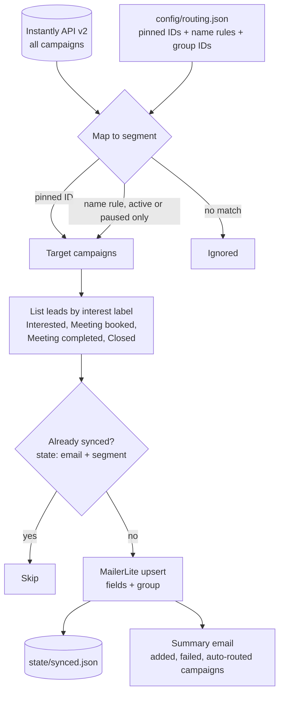

# Interested Lead Sync: cold-email replies that showed interest, routed into the right nurture group

A small weekday job that closes the gap between the cold-email tool and the email marketing platform. It pulls every lead Instantly has labeled as interested, works out which audience the campaign belongs to, and adds the contact to the matching MailerLite group. Reruns are safe and new campaigns are picked up automatically.

## The problem

Cold email ran in Instantly. Newsletters and nurture sequences ran in MailerLite. Nothing connected them, so a prospect who replied with interest got an answer but only reached the nurture list if someone copied the address across by hand. Three things made a simple export unworkable:

- **Not every reply is a lead.** Out-of-office, neutral and not-interested replies should never land on a marketing list.
- **Different campaigns feed different audiences.** A domestic wholesale lead and an international distributor need different nurture content.
- **New campaigns launch without notice.** A sync keyed to a fixed list of campaign IDs silently ignores the next wave.

## What it does

`src/sync.js` runs every weekday morning:

1. Lists every campaign in the Instantly workspace.
2. Maps each to a segment: pinned campaign IDs first, then regex rules on the campaign name.
3. For each mapped campaign, pulls leads under four interest labels: Interested, Meeting booked, Meeting completed and Closed.
4. Skips anyone already synced to that segment.
5. Upserts the rest into the segment's MailerLite group with name, company, phone and country.
6. Emails a summary only when something was added or failed, and lists any campaign that was routed by a name rule.

## Architecture



## Key design decisions

**Interest is defined by label, not by reply.** Only leads carrying one of four positive labels are synced. A reply alone is not enough, which keeps out-of-office and "not interested" contacts off the marketing list.

**Pinned IDs for certainty, name rules for coverage.** Known campaigns are mapped by ID in `config/routing.json`. Any other campaign whose name matches a rule is routed automatically, but only while it is active or paused, so old finished campaigns with similar names are not swept in.

**Auto-routing is always reported.** Every campaign routed by a name rule is listed in the summary email with its ID and segment. The owner can pin it or correct the rule, and a new wave is never skipped or misrouted without someone seeing it.

**Idempotent at two levels.** MailerLite's subscriber endpoint upserts by email, so pushing an existing contact only adds the group. The job also keeps its own record keyed by `email|segment`, so a normal run makes no MailerLite calls for contacts it has already handled.

**Empty secrets fall through to config.** Group IDs are read from an env var first and from `routing.json` second. A repository secret that exists but is empty no longer breaks the run, which is what happened on the first production run.

**Failures are isolated and visible.** One failed lead or one failed label query is recorded and the run continues. The process exits non-zero if anything failed, so the workflow shows red and the summary email lists each failure.

**Quiet by default.** No email is sent on a run that added nothing and failed nothing.

## Repository layout

```
src/sync.js                  Instantly listing, routing, MailerLite upsert, state, summary
config/routing.example.json  segments, group IDs, pinned campaigns, name rules
.github/workflows/sync.yml   weekday run, state carried in the Actions cache
```

## Setup

Requires Node 20+, an Instantly API v2 key and a MailerLite API key.

```bash
npm install
cp .env.example .env                                # fill in values
cp config/routing.example.json config/routing.json  # your groups, campaigns and rules
npm run dry-run                                     # lists what would be added, pushes nothing
npm run sync
```

| Variable | Purpose |
|---|---|
| `INSTANTLY_API_KEY` | Campaign and lead listing |
| `MAILERLITE_API_KEY` | Subscriber upserts |
| `MAILERLITE_GROUP_<SEGMENT>` | Optional override of a group ID from `routing.json`, for example `MAILERLITE_GROUP_WHOLESALE` |
| `GMAIL_USER`, `GMAIL_APP_PASSWORD`, `EMAIL_NOTIFY` | Optional summary email |
| `CONFIG_DIR`, `STATE_DIR` | Override the `config/` and `state/` locations |

Adding an audience means adding one entry under `groups` and one name rule. No code change.

Scheduled runs are off by default. Set the repository variable `ENABLE_SCHEDULE` to `true` to turn the schedule on; manual runs from the Actions tab always work.

---

Extracted from a production automation suite I built and ran for a live e-commerce and B2B wholesale business, 2026.

© Michael Wootan. Source shared for portfolio review; all rights reserved.
